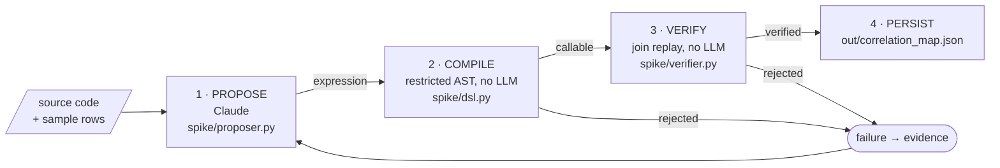

# Architecture

The model may be creative about **what** the mapping is. It is never trusted on **whether** it
is correct: the data decides that.



[`spike/loop.py`](spike/loop.py) drives the stages for up to 3 attempts (`--max-attempts`).

## Stages

**1. Propose.** Claude gets the source code, sample source rows and sample target values. It
returns a structured proposal through `messages.parse` and a Pydantic schema: an expression, the
fields it uses, and the exact lines of code it relied on. `StubProposer` is the offline stand-in.

**2. Compile.** The expression is parsed with Python's `ast` module and checked against a fixed
list of allowed operations. There is no `eval` or `exec`.

```
allowed   sha256 sha1 md5 lower upper strip reverse replace split
          regex_extract b64encode b64decode concat   +   [a:b]
rejected  everything else
```

**3. Verify.** The expression is applied to 200 source rows, and each result is looked up on the
target side.

| join_yield | verdict |
|---|---|
| ≥ 0.95 | verified |
| ≥ 0.50 | probable |
| < 0.50 | rejected |

There is also a degeneracy check. If many inputs collapse to the same output, the result is
rejected even at join_yield 1.0. This catches an expression like `replace(user_id, user_id, "x")`,
which would otherwise "match" everything.

**4. Persist.** The edge is written with its expression, evidence and measured result:

```json
{
  "kind": "transform",
  "from": {"hop": "middleware-auth (Splunk)", "fields": ["request_id", "user_id"]},
  "to":   {"hop": "payments DB (Azure SQL)", "field": "internal_tx_hash"},
  "transform": {"expr": "sha256(request_id + \":\" + user_id)[:16]"},
  "evidence": [{"file": "sample_app/payment_service.py", "lines": "48-51", "quote": "..."}],
  "confidence": "verified",
  "verification": {"method": "join_replay", "sampled": 200, "matched": 195, "join_yield": 0.975}
}
```

If nothing verifies, the run ends `UNRESOLVED` and `edges` is empty. It never guesses.

## Files

| Path | Role |
|---|---|
| `sample_app/payment_service.py` | Code under analysis: the real transform and two decoys |
| `data/generate.py` | Builds the dataset by importing the sample app, so data can't drift from code |
| `spike/proposer.py` | Prompt, Claude and stub proposers, pricing |
| `spike/dsl.py` | Sandboxed expression compiler and interpreter |
| `spike/verifier.py` | Join replay, thresholds, degeneracy check |
| `spike/loop.py` | Retry loop and correlation-map output |
| `run.py` | Command-line interface |
| `tests/` | 36 offline tests |
